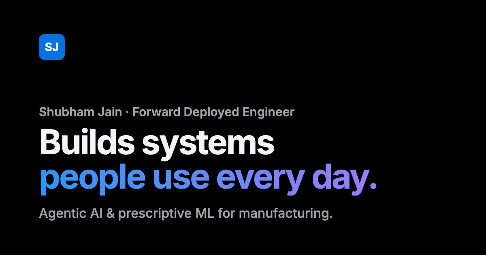

# Shubham Jain — Portfolio

Personal portfolio of a Forward Deployed Engineer building production agentic AI and prescriptive ML for heavy manufacturing.

**Live site:** https://superbham26.github.io/portfolio/

[](https://superbham26.github.io/portfolio/)

## Highlights

- Story-led intro and featured projects, followed by a bento grid of projects, experience and stack
- Detail sheets built on the native `<dialog>` element, with focus returned to the opener on close
- Light and dark themes that follow the system, with a manual toggle remembered across visits
- Respects `prefers-reduced-motion`, `prefers-contrast` and `prefers-reduced-transparency`
- Content is static HTML, so it works without JavaScript and renders fully in link previews and search

## Tech

Plain HTML, CSS and JavaScript. No framework, no build step, no dependencies.

```
index.html       Page content
404.html         Not-found page
css/styles.css   Styles and theme tokens
js/init.js       Runs before first paint: theme and JS flag
js/main.js       Detail sheets, counters, reveal animations, theme toggle, mobile menu
assets/          Social preview image and icons
resume.pdf       Downloadable résumé
```

## Run locally

```sh
python3 -m http.server 8000
```

Then open http://localhost:8000.

## Deployment

Hosted on GitHub Pages from the `main` branch root. Every push to `main` goes live.

## License

The code is available under the [MIT License](LICENSE). The written content, résumé and images are © Shubham Jain, all rights reserved.
